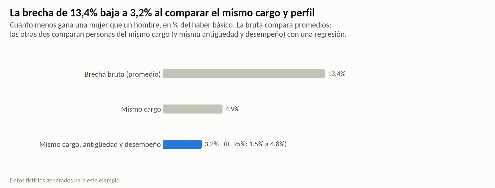
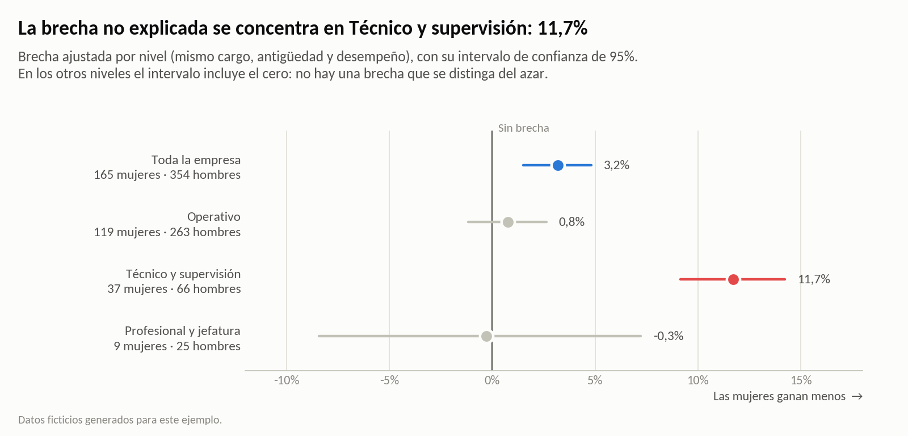
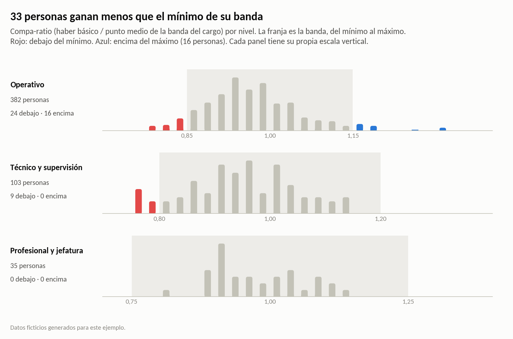
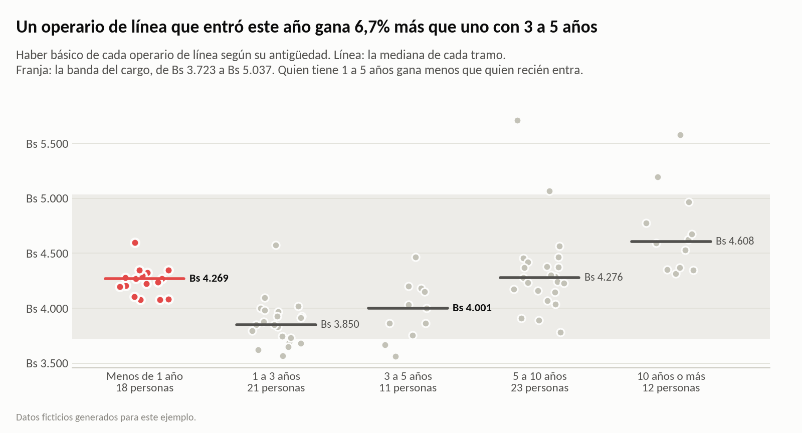
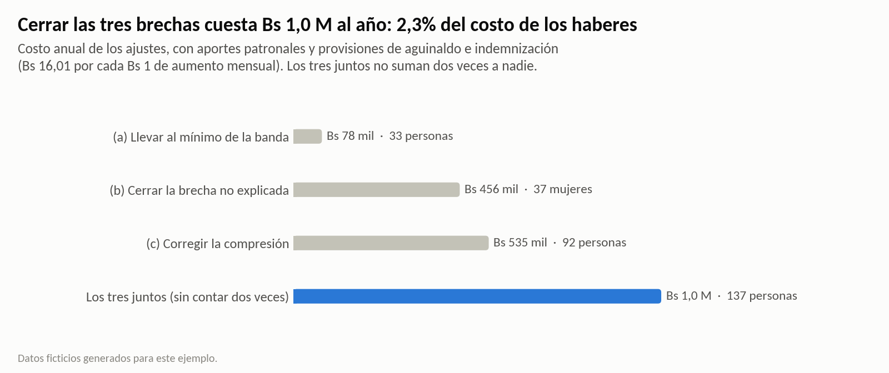

# ¿Se paga igual por el mismo trabajo?

**Análisis de equidad salarial con Python.** Este análisis separa la brecha de género que se explica por el cargo de la que no se explica y muestra dónde se concentra. También identifica quién está fuera de su banda salarial, calcula cuánto cuesta en bolivianos cerrar cada brecha y entrega una lista priorizada de ajustes.



> **Datos ficticios.** Corresponden a una foto al 30/09/2026 de los 520 colaboradores activos de una embotelladora mediana, con la banda salarial de cada cargo, y se generan con `generar_datos.py`. El generador incluye a propósito, con ruido, una brecha no explicada, compresión salarial y sueldos fuera de banda, para probar que el método los encuentra. Los números no describen a ninguna empresa real.

## Resultados

| Pregunta | Respuesta |
|---|---|
| ¿Hay brecha? | Sí. En promedio, las mujeres ganan **13,4%** menos que los hombres (**7,4%** en la mediana). |
| ¿Es por el mismo trabajo? | En su mayor parte, no. Según Oaxaca-Blinder, el **70%** de la brecha se explica por cargo, antigüedad y desempeño; el cargo solo explica el 58%. Entre personas del mismo cargo, antigüedad y desempeño, la brecha baja a **3,2%** (IC 95%: 1,5% a 4,8%). |
| ¿Dónde está la brecha que no se explica? | En **Técnico y supervisión**: **11,7%** (IC 95%: 9,1% a 14,2%). En los niveles Operativo y Profesional y jefatura no se distingue de cero. Las 37 mujeres de Técnico y supervisión ganan menos de lo esperado para un hombre con su perfil. |
| ¿Cuánto cuesta corregirlo? | **Bs 1.008.264 al año** las tres brechas juntas, el 2,3% del costo anual de los haberes. Por separado: corregir la compresión en 3 cargos operativos, **Bs 535.454**; cerrar la brecha de género, **Bs 456.036**; llevar al mínimo de su banda a las **33** personas que están debajo, **Bs 78.233**. |
| ¿Qué hacer primero? | **Revisar caso por caso a las 37 mujeres de Técnico y supervisión.** Cerrar su brecha cuesta **Bs 456.036 al año** (Bs 28.493 por mes). En cada caso, antes de ajustar, conviene buscar una razón que los datos no ven, como la experiencia previa o la formación. |

Una brecha no explicada **no prueba discriminación**, porque puede haber razones que estos datos no miden. Pero obliga a revisar caso por caso.

## Cómo se hizo

1. **Brecha bruta.** Es la diferencia entre el haber básico de hombres y mujeres, en promedio y en mediana.
2. **Brecha ajustada.** Es una regresión del logaritmo del haber sobre mujer, cargo, antigüedad (también al cuadrado) y desempeño, con errores robustos HC3 (statsmodels). El coeficiente de *mujer*, pasado a %, es la brecha entre personas comparables. El único cargo con una sola persona queda fuera, porque no permite comparar.
3. **Oaxaca-Blinder.** Divide la brecha en una parte explicada (cargo, antigüedad y desempeño) y otra no explicada, con el modelo conjunto como referencia. Se calcula a mano y se controla con `OaxacaBlinder` de statsmodels.
4. **Dónde se concentra.** Se estima el mismo modelo con una brecha para cada nivel y para cada área. Por área se repite sin Técnico y supervisión y se corrige por comparaciones múltiples (Bonferroni): así se ve que la brecha sigue al nivel más que al área.
5. **Bandas y compresión.** El compa-ratio (haber / punto medio de la banda) muestra quién está fuera de política. Para la compresión se compara, en cada cargo operativo, la mediana de quienes entraron en el último año con la de quienes tienen 3 a 5 años.
6. **Costo y lista de ajustes.** Subir Bs 1 el haber mensual cuesta 12 × (1 + 0,1671 + 2/12) = **Bs 16,01 al año**. Son 12 sueldos, 16,71% de aportes patronales sobre esos sueldos y 2 sueldos más de provisiones de aguinaldo e indemnización (1/12 por mes cada una). Con ese factor se costean tres ajustes:
   - (a) llevar a todos al mínimo de su banda;
   - (b) llevar a cada mujer del nivel con brecha a lo que el modelo predice para un hombre con su mismo cargo, antigüedad y desempeño;
   - (c) en los cargos con compresión, llevar a quien tiene 1 año o más a la mediana de los ingresos recientes.

   La lista `resultados/ajustes_sugeridos.csv` tiene una fila por persona, con su motivo y el ajuste mensual sugerido. Si alguien tiene más de un motivo, cuenta el ajuste más alto.





| | |
|---|---|
|  |  |

## Estructura

```
├── analisis_equidad.ipynb      análisis completo, con resultados y gráficos
├── generar_datos.py            genera los datos ficticios (semilla fija)
├── graficos.py                 estilo de los gráficos
├── requirements.txt
├── datos/
│   ├── colaboradores.csv       una fila por persona activa al 30/09/2026
│   └── bandas.csv              banda salarial de cada cargo: mínimo, punto medio y máximo
├── resultados/
│   └── ajustes_sugeridos.csv   lista priorizada: motivo y ajuste mensual sugerido por persona
└── img/                        gráficos del análisis
```

## Cómo correrlo

```bash
pip install -r requirements.txt
python generar_datos.py          # opcional: los datos ya están en datos/
jupyter notebook analisis_equidad.ipynb
```

## Límites

- **Una brecha no explicada no prueba discriminación.** El modelo no ve la experiencia previa, la formación, los turnos ni la negociación al ingresar. Por eso la lista es una agenda para revisar caso por caso, no una decisión automática.
- **Hay pocos casos en algunos grupos.** Hay 9 mujeres en Profesional y jefatura y 3 en Mantenimiento: ahí el análisis no puede descartar una brecha.
- **El ajuste (b) cubre solo el nivel donde la brecha es distinta de cero.** Aplicar la misma regla a todas las mujeres costaría Bs 695.986 al año, pero en los otros niveles esas diferencias son la misma variación que tienen los hombres.
- **El costo es una foto.** No incluye el efecto en las horas extra ni en el incremento de mayo, que se aplica sobre el haber ajustado. Con datos reales, las bandas y las reglas de ajuste se revisan con Finanzas.

**Herramientas:** Python · pandas · statsmodels · matplotlib

---

### English summary

This is a pay equity analysis of a fictional bottling company with 520 employees, using synthetic data (a snapshot at 30 September 2026).
- The raw gender pay gap is 13.4%. Job, tenure and performance explain 70% of it (Oaxaca-Blinder), and the adjusted gap is 3.2% (OLS on log pay with HC3 errors).
- The unexplained gap is concentrated in technical and supervisory roles (11.7%). In addition, 33 employees are paid below their salary band and three operational jobs show pay compression.
- Closing the three gaps costs Bs 1,008,264 a year. The first step is a case-by-case review of the 37 women in technical and supervisory roles (Bs 456,036 a year).

---

Vicente Asbun · [LinkedIn](https://www.linkedin.com/in/vicente-antonio-asbun-karmy-30aa19164/)
